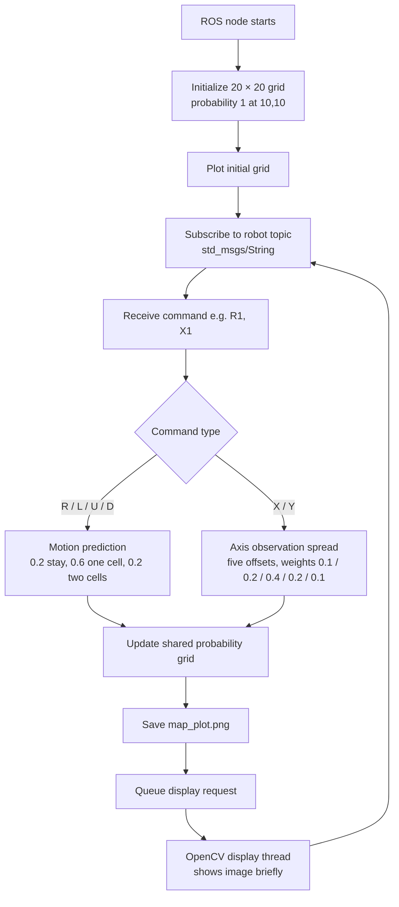

# Probabilistic Grid Localization

This ROS 1 project maintains a 20 × 20 probability grid and updates it from motion-prediction or observation commands. The implementation uses fixed transition and observation probability arrays, renders map images with Matplotlib, and displays them with OpenCV.

## Contents

- The Python node in `src/` implements the probability-grid updates.
- The launch file in `launch/` starts the ROS node.
- `package.xml` and `CMakeLists.txt`: catkin package metadata.

## Implementation summary

The node represents the robot's location as a 20 × 20 probability grid. It starts with all probability at cell `(10, 10)`. Each command received on the `robot` topic selects one of two grid-update routines:

- **Motion prediction (`R`, `L`, `U`, `D`)**: for each requested step, the code distributes a cell's probability over three offsets in the selected direction: no movement, one cell, and two cells. The configured weights are `[0.2, 0.6, 0.2]`. When an offset crosses the grid boundary, the code redirects some of that probability to an in-bounds offset.
- **Observation update (`X`, `Y`)**: the code spreads each cell's probability over five offsets along the selected axis, with weights `[0.1, 0.2, 0.4, 0.2, 0.1]`. Out-of-grid offsets are redirected to an in-grid position. This is implemented as a spatial spread; there is no measurement value in the command and no separate sensor-likelihood/Bayes normalization step.

After an update, the node plots the grid to `map_plot.png`. A worker thread reads that image and briefly displays it in an OpenCV window. The ROS callback accepts a direction letter followed by one digit, such as `R1` or `X1`.

The update routines mutate the shared grid in place while iterating over cells, and the prediction routine reuses its accumulator across steps. Consequently, the implementation should be treated as an academic prototype: its results may not preserve a normalized probability distribution or match a conventional Bayes filter.

## Project flow



## Requirements

ROS 1 with `rospy` and `std_msgs`, plus Python packages NumPy, Matplotlib, and OpenCV. The display code opens GUI windows, so it needs a graphical desktop. The program writes `map_plot.png` in its current working directory.

## Build and run

Place this repository, with `package.xml` at its root, in a catkin workspace's `src/` directory, then build and launch:

```bash
cd ~/catkin_ws
catkin_make
source devel/setup.bash
roslaunch <package-name> <launch-file>
```

The node subscribes to the `robot` topic (`std_msgs/String`). Commands are a direction letter followed by one digit: `R`, `L`, `U`, or `D` selects a motion prediction; `X` or `Y` selects an observation update. For example:

```bash
rostopic pub -1 /robot std_msgs/String "data: 'R1'"
rostopic pub -1 /robot std_msgs/String "data: 'X1'"
```

The included node also advertises `robot` but does not publish commands itself.

## Notes

This is an academic prototype and has not been verified for correctness or runtime stability. The node mutates probability arrays in place and starts a display thread; inspect these behaviors before using the output as a reliable localization estimate.
